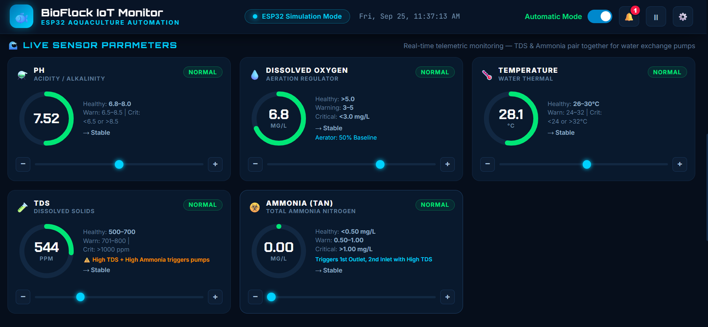
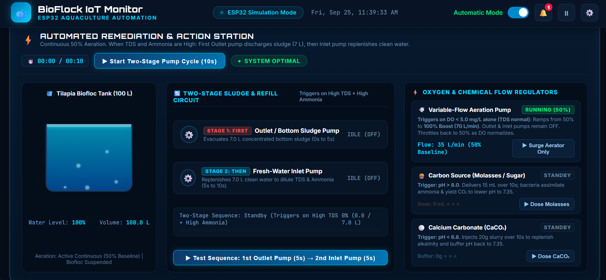
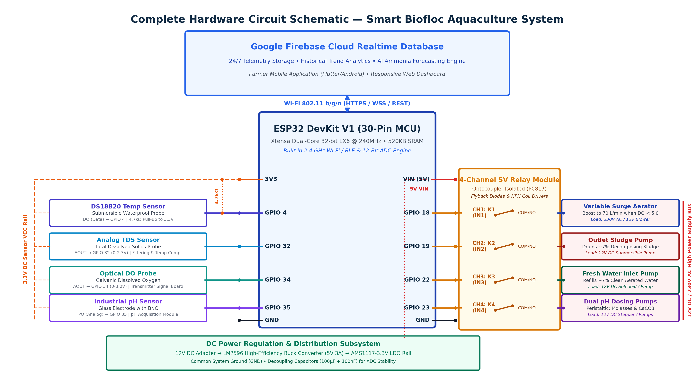
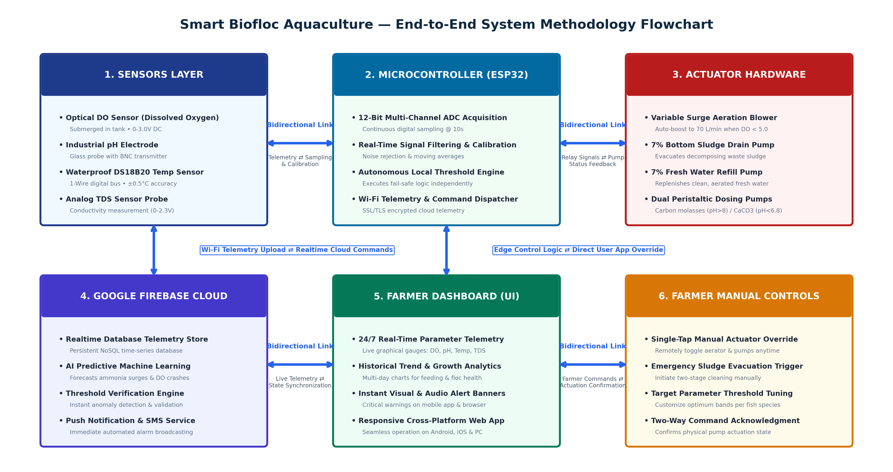

# Smart Biofloc Aquaculture Monitoring and Automated Management System

**Undergraduate B.Tech Computer Science & Engineering (Data Science) Major Project**  
*Bishop Jerome Institute, Kollam — APJ Abdul Kalam Technological University (KTU), Kerala, India*  
*Academic Year: 2026–2027*

---

## Academic Record & Project Metadata

- **Institution:** Bishop Jerome Institute, Kollam
- **Affiliation:** APJ Abdul Kalam Technological University (KTU), Kerala, India
- **Department:** Department of Computer Science and Engineering (Data Science)
- **Project Guide:** Prof. Manju J, Assistant Professor, Dept. of CSE, BJI
- **Project Team:**
  - Adith H.
  - Amal Raj
  - Nabeel Shajahan
  - Sefen Mathew
- **Academic Presentation:** Certified presentation slides and project documentation are preserved in the institutional archive and available upon academic request.

---

## Software Development & Integration Responsibilities

Within this collaborative four-member undergraduate major project, my specific responsibilities focused on the **software development, data engineering, model integration, and containerization** layers:

1. **Backend Service & Ingestion Pipeline:** Developed the asynchronous FastAPI backend service, including Pydantic v2 schema validation, MQTT consumer handling via Eclipse Mosquitto, edge ingestion webhooks, and real-time Server-Sent Events (SSE) broadcasting.
2. **Time-Series Persistence:** Implemented the column-oriented storage schema in QuestDB, executing high-throughput ingestion via Influx Line Protocol (ILP) over raw TCP sockets.
3. **Machine Learning & Concept Drift Integration:** Integrated the LightGBM predictive dissolved oxygen forecasting module (2-hour lookahead) and the ADWIN-inspired streaming forecast residual monitor into the backend service and API.
4. **Operator Action Center Interface:** Integrated the frontend Action Center and actuator control components in React and TypeScript, exposing live tank water level metrics (20,000 L vessel capacity), variable aeration controls, sludge evacuation, clean water refill, and chemical dosing indicators with safety interlock logic.
5. **Container Orchestration:** Configured the multi-container development environment across all 7 services using Docker Compose.
6. **Testing & Quality Assurance:** Authored the automated test suites verifying API contracts, numerical simulation bounds, and live container integration.

*Hardware Demarcation:* Physical sensor selection (optical DO probes, industrial glass pH electrodes, DS18B20 temperature probes, TDS sensors), analog signal conditioning, ESP32 microcontroller wiring, and relay circuitry were handled by engineering teammates as documented in [`docs/ACADEMIC_SCOPE.md`](docs/ACADEMIC_SCOPE.md).

---

## Problem Statement & Biological Foundation

Zero-Water-Exchange Biofloc Technology (BFT) operates at high stocking densities (50–100 kg/m³ for tilapia or 150–300 shrimp/m²). Unlike conventional flow-through ponds, biofloc relies on a dense, suspended microbial community of heterotrophic bacteria to assimilate toxic ammonia into single-cell microbial protein.

However, this biological density creates **critical operational vulnerabilities**:
- **Elevated Respiration Demand:** The dense microbial biofloc consumes substantial dissolved oxygen alongside cultured fish.
- **Hypoxia Vulnerability:** If aeration fails, Dissolved Oxygen (DO) can drop from optimal levels (5–7 mg/L) to lethal hypoxic thresholds (< 4.0 mg/L) within 1 to 2 hours.
- **Toxic Unionized Ammonia ($NH_3$):** Total Ammonia Nitrogen (TAN) alone does not indicate acute toxicity; toxic unionized ammonia ($NH_3$) increases sharply at higher temperatures and alkaline pH. The system computes this dynamically using the Emerson equilibrium equation:
  
  $$f = \frac{1}{10^{\text{pK}_a - \text{pH}} + 1}, \quad \text{pK}_a = \frac{2729.92}{T_K} + 0.09018, \quad NH_3 = \text{TAN} \times f$$

Traditional manual dip-testing (1–2 times daily) cannot capture nocturnal oxygen depletion or rapid biochemical swings, motivating a continuous real-time monitoring and automated remediation platform.

---

## System Architecture

The platform is orchestrated as a pure Docker Compose environment with 7 isolated microservices:

```
┌─────────────────────────────────┐        ┌──────────────────────────────────┐
│   Euler-Maruyama SDE Engine     │        │    Edge Microcontroller (ESP32)  │
│  (Stochastic Synthetic Telemetry)│        │    (Physical Analog / Digital)   │
└────────────────┬────────────────┘        └────────────────┬─────────────────┘
                 │ MQTT (Topic: telemetry)                  │ HTTP POST (/api/telemetry)
                 ▼                                          │
┌─────────────────────────────────┐                         │
│   Eclipse Mosquitto Broker      │                         │
│   (Port 1883 / Port 9001)       │                         │
└────────────────┬────────────────┘                         │
                 │ Asynchronous MQTT Subscription           │
                 ▼                                          ▼
┌─────────────────────────────────────────────────────────────────────────────┐
│                             FastAPI Backend                                 │
│  • Pydantic v2 Schema Validation  • Emerson NH3 Real-Time Equilibrium Engine│
│  • LightGBM Quantile Inference    • ADWIN Streaming Residual Drift Detector │
│  • ControlService (AUTO/MANUAL)   • Dual Broadcaster (In-Memory / Redis)    │
└──────────────────┬───────────────────────┬──────────────────────┬───────────┘
                   │ ILP over TCP (9009)   │ SQL Queries (9000)   │ SSE Stream (/api/stream)
                   ▼                       ▼                      ▼
┌────────────────────────────────────────────────────────┐ ┌──────────────────┐
│                  QuestDB Time-Series                   │ │  React Dashboard │
│  • Column-oriented fast TCP append (ILP)               │ │  • Action Center │
│  • Microsecond timestamping & historical SQL engine   │ │  • Live Telemetry│
│  • Web Console on Port 9000                            │ │  • Vite + TS     │
└────────────────────────────────────────────────────────┘ └──────────────────┘
```

---

## Key Modules & Features

### 1. Stochastic Biofloc Telemetry Simulator
- Implements an Euler-Maruyama discretized Ornstein-Uhlenbeck stochastic differential equation (SDE) model.
- Simulates realistic diurnal DO cycles, photosynthetic production, water temperature shifts, feeding excretion, and sudden aerator failure scenarios with reproducible random seeds.

### 2. Time-Series Persistence Engine (QuestDB + ILP)
- Streams sensor records directly into QuestDB using the Influx Line Protocol (ILP) over a raw TCP socket (`port 9009`).
- Eliminates relational database bottlenecks, enabling nanosecond ingestion latency and sub-millisecond analytical SQL queries (`port 9000`).

### 3. Predictive Dissolved Oxygen Forecasting (LightGBM)
- Predicts DO levels **2 hours in advance** using 27 canonical features (rolling statistics, rates of change, biochemical cross-interactions).
- Generates empirical lower and upper uncertainty bounds ($\alpha = 0.05, 0.95$) alongside the point prediction.
- Achieves a **69.64% reduction in RMSE** relative to the standard persistence baseline on synthetic held-out validation data ($0.1507\text{ mg/L}$ vs $0.4963\text{ mg/L}$).

### 4. Streaming Residual Concept Drift Detector (ADWIN)
- Monitors the true 2-hour forecast residual stream ($e_t = |y_{t+2h} - \hat{y}_{t+2h}|$) using adaptive sub-windows governed by Hoeffding bounds ($\delta = 0.002$).
- Automatically detects distributional shifts caused by simulated mechanical blower failure or organic overloading.

### 5. Farmer Action Center & Actuator Control
- Models operational tank boundaries: **20,000 L capacity** with **12,000 L minimum safe level** and **19,000 L maximum safe level**.
- Supports 3 operational modes: `AUTO` (algorithmic control), `MANUAL` (operator override with confirmation modal), and `SIMULATION` (virtual environment testing).
- Actuator controls include:
  - **Aeration System:** Baseline 50% capacity ($35\text{ L/min}$), boosting to 100% ($70\text{ L/min}$) upon DO depletion.
  - **Two-Stage Sludge & Refill:** Evacuates ~7% bottom sludge and dead floc via outlet pump, followed by clean water replenishment via inlet pump.
  - **Chemical Dosing Pumps:** Automatic carbon source (molasses/sugar) dosing for high pH ($> 8.0$) to stimulate bacterial $\text{CO}_2$ release, and buffer ($\text{CaCO}_3$) dosing for low pH ($< 6.8$).
  - **Hardware Safety Interlocks:** Prevents tank overflow, prevents dry pump running, and enforces emergency aeration locks.

---

## Application User Interface & Control Center

| Live 24/7 Telemetry Dashboard | Automated Remediation & Actuator Control |
| :---: | :---: |
|  |  |

---

## Hardware Integration & System Methodology

| Microcontroller Edge Hardware Schematic | End-to-End Methodology Flowchart |
| :---: | :---: |
|  |  |

---

## Technology Stack

| Domain | Technology | Version | Purpose |
| :--- | :--- | :--- | :--- |
| **Backend & API** | Python, FastAPI, Uvicorn | 3.11, 0.110+ | Asynchronous REST endpoints, SSE streaming, and business logic |
| **Data Validation** | Pydantic v2 | 2.6+ | Strict schema parsing and physical range validation |
| **Messaging Broker**| Eclipse Mosquitto | 2.0 | MQTT broker for IoT telemetry ingestion |
| **Time-Series DB** | QuestDB | Latest | Column-oriented Influx Line Protocol (ILP) and SQL engine |
| **Distributed Cache**| Redis | 7-alpine | In-memory pub/sub broker for multi-worker scaling |
| **Machine Learning**| LightGBM, Scikit-learn | 4.7+, 1.4+ | 27-feature quantile regression forecasting model |
| **Drift Monitoring**| ADWIN (Adaptive Windowing) | Custom | Streaming forecast error distribution shift detection |
| **Frontend UI** | React 18, TypeScript, Vite | 18.2, 5.4 | Real-time reactive dashboard, Action Center, interactive scenarios |
| **Styling** | TailwindCSS, Lucide Icons | 3.4 | Modern responsive operational interface |
| **DevOps** | Docker, Docker Compose | 24+, v2.20+ | Multi-container isolated microservice orchestration |

---

## Automated Testing & Verification

The repository contains an automated test suite verifying correctness across all subsystems:

```bash
# Tier 1: Unit, Schema, ML Quantile, and Stability Tests (pytest)
docker compose exec -T backend pytest -v tests/test_simulator.py tests/test_backend.py tests/test_ml.py

# Tier 2: Live Container Integration & End-to-End Tests (unittest)
python3 tests/test_e2e.py
```

### Verified Test Summary
- **Tier 1 (pytest — 23 tests):**
  - SDE parameter bounds and bit-identical reproducibility verified.
  - Emerson $NH_3$ equilibrium verified against physical chemical tables.
  - Pydantic bounds, broadcaster FIFO buffers, and QuestDB ILP serialization verified.
  - 27-feature engineering ordering and chronological sorting verified.
  - LightGBM artifact loading and quantile ordering ($q_{0.05} \le \hat{y} \le q_{0.95}$) verified.
  - Delayed 2-hour residual tracking and ADWIN detector stability verified.
- **Tier 2 (unittest — 7 tests):**
  - Live QuestDB SQL connection, FastAPI health checks, telemetry ingestion webhooks, ML forecast endpoints, and scenario controls verified against active containers.
- **Result:** **30 passed, 0 failed (100% PASS)**. Complete logs in [`docs/TESTING_AND_VERIFICATION.md`](docs/TESTING_AND_VERIFICATION.md).

---

## Quickstart Instructions

### 1. Prerequisites
- Docker Engine 24.0+ and Docker Compose v2.20+.
- No local Python, Node.js, or database installations required on host.

### 2. Launch the Platform
```bash
# Clone the repository
git clone https://github.com/git-nxbl/smart-biofloc-aquaculture.git
cd smart-biofloc-aquaculture

# Start all 7 services in detached mode
docker compose up -d

# Verify all containers are healthy
docker compose ps
```

### 3. Service Endpoints
- **Web Dashboard & Action Center:** `http://localhost:3000`
- **FastAPI Interactive API Docs (Swagger):** `http://localhost:8000/docs`
- **QuestDB SQL Console:** `http://localhost:9000`

### 4. Teardown
```bash
# Stop containers and preserve database volumes
docker compose down

# Stop containers and wipe volumes (clean state)
docker compose down -v
```

---

## Complete Academic Documentation Suite

The complete engineering documentation is preserved in `docs/`:

1. [`docs/ARCHITECTURE.md`](docs/ARCHITECTURE.md): Microservice topology, data flow specifications, and network security analysis.
2. [`docs/ML_VALIDATION.md`](docs/ML_VALIDATION.md): 27-feature design, baseline models, quantile regression evaluation, and ADWIN drift detection.
3. [`docs/TESTING_AND_VERIFICATION.md`](docs/TESTING_AND_VERIFICATION.md): Test harness architecture, test suites, and verified execution transcripts.
4. [`docs/SCIENTIFIC_FOUNDATION.md`](docs/SCIENTIFIC_FOUNDATION.md): Biofloc biological kinetics, $C:N$ ratios, Emerson ammonia equations, and peer-reviewed citations.
5. [`docs/ACADEMIC_SCOPE.md`](docs/ACADEMIC_SCOPE.md): Formal boundary between student software implementation and teammate hardware scope.
6. [`docs/PROJECT_HANDOVER.md`](docs/PROJECT_HANDOVER.md): Comprehensive KTU viva defense script, architecture walkthrough, and troubleshooting guide.
7. [`docs/PROJECT_AUDIT.md`](docs/PROJECT_AUDIT.md): Technical debt resolution and architectural audit records.
8. **Institutional Presentation & Defense Deck:** Archived in college records; available upon academic request.

---

## Academic Scope & Demarcation Notice

- **Software Scope (Implemented in this repository):** Mathematical simulation, asynchronous messaging, time-series database design, machine learning pipelines, concept drift detection, and real-time frontend dashboard.
- **Hardware Scope (Teammate / Future Work):** Selection of physical probes (optical DO, glass pH, thermistor), ESP32 ADC wiring, firmware development, IP67 field enclosures, and physical probe calibration.
- **Scientific Status:** Software verification complete; scientific relationships and modelling assumptions reviewed; ML evaluated on synthetic held-out telemetry. **Real-world commercial farm deployment has not been performed.**
